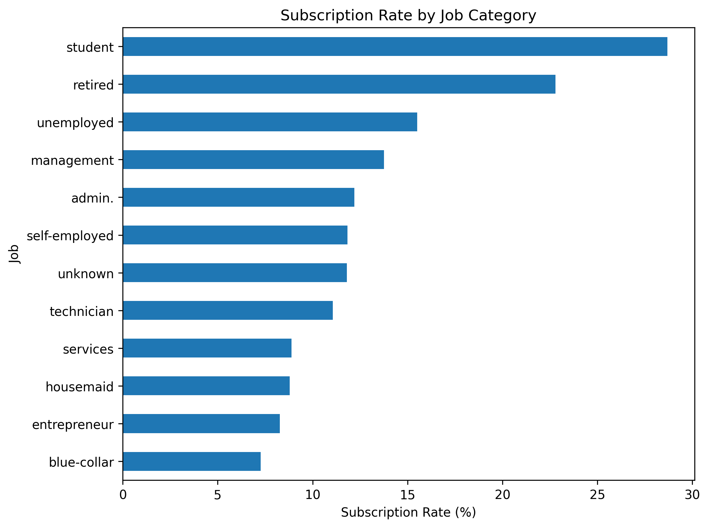
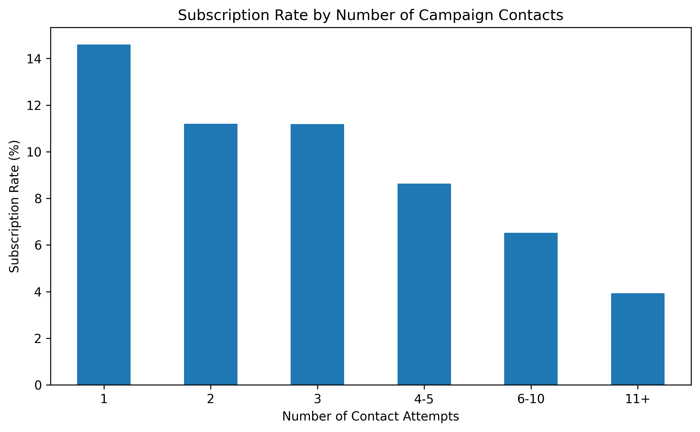
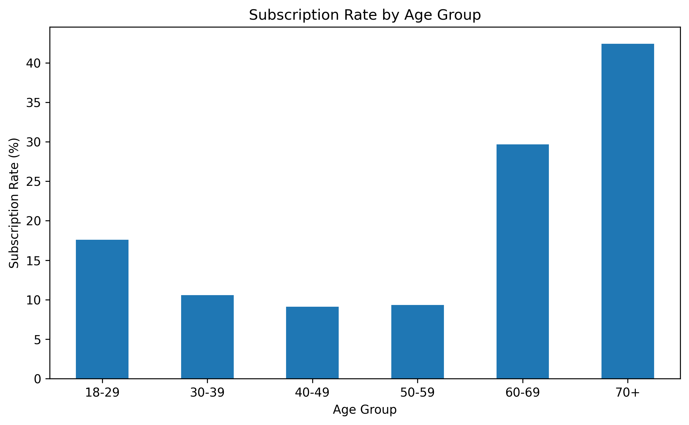
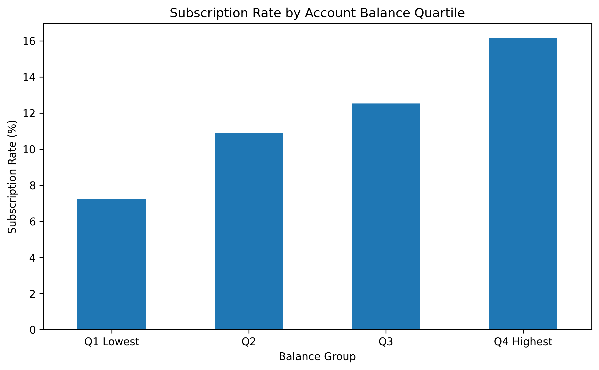
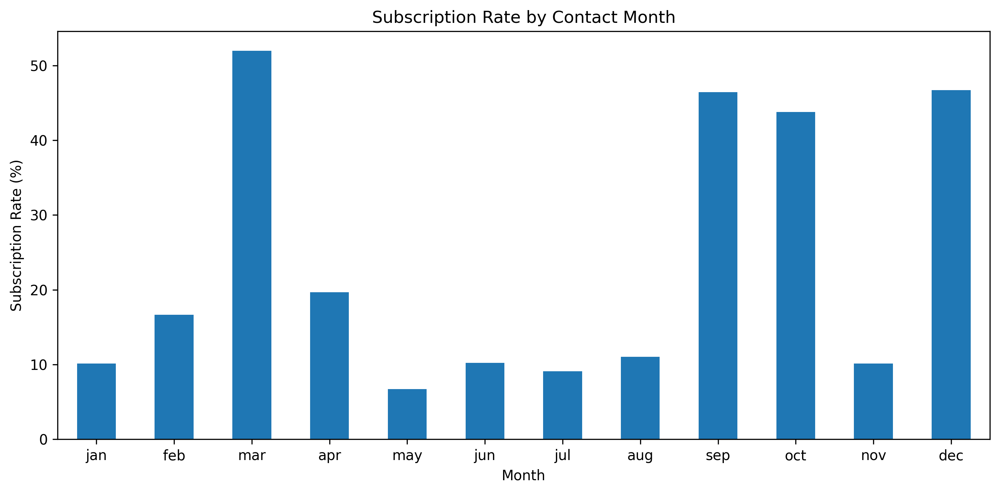

# Bank Marketing Campaign Analysis

## Project Overview

This project analyzes a bank direct-marketing campaign to understand which customer groups are most likely to subscribe to a term deposit.

The analysis combines:

- Exploratory Data Analysis (EDA)
- Statistical testing
- Logistic regression
- SQL business analysis

The objective is to identify useful customer and campaign patterns that could support more effective marketing targeting.

---

## Dataset

The project uses the UCI Bank Marketing dataset.

The dataset contains:

- **45,211 customer records**
- **17 original variables**
- Customer demographics
- Account and loan information
- Campaign contact information
- Previous campaign history
- Term-deposit subscription outcome

The target variable is:

- `y = yes` → customer subscribed
- `y = no` → customer did not subscribe

Overall campaign subscription rate:

- **11.7% subscribed**
- **88.3% did not subscribe**

---

## Tools Used

### Python

- Pandas
- NumPy
- Matplotlib
- SciPy
- Scikit-learn

### SQL

- PostgreSQL
- pgAdmin

### Development Environment

- Jupyter Notebook
- Visual Studio Code
- Git / GitHub

---

## Project Workflow

The project followed five main stages:

1. Data quality and initial inspection
2. Exploratory data analysis
3. Statistical testing
4. Logistic regression modelling
5. SQL business analysis

---

## Data Quality

Initial checks found:

- No conventional missing values
- No duplicate rows
- 7 numeric variables
- 10 categorical variables

Several categorical variables contained `"unknown"` values. These were retained as recorded categories rather than automatically removed.

---

## Exploratory Data Analysis

### Overall Campaign Performance

The campaign converted approximately:

**11.7% of contacted customers**

This represents 5,289 subscribers from 45,211 customers.

---

### Subscription Rate by Job

Some customer occupations showed substantially higher response rates.

Notable examples:

- Students: **26.88%**
- Retired: **22.79%**
- Unemployed: **15.50%**
- Management: **13.76%**
- Blue-collar: **7.28%**



Students and retired customers showed strong response rates, although both groups were considerably smaller than categories such as management or blue-collar workers.

---

### Subscription Rate by Education

Subscription rates increased across education levels:

- Tertiary: **15.01%**
- Unknown: **13.57%**
- Secondary: **10.56%**
- Primary: **8.63%**

Education showed differences in response rates, although later statistical testing showed that the relationship was relatively weak.

---

### Housing and Personal Loans

Customers without existing loans were more responsive.

#### Housing Loan

- No housing loan: **16.70%**
- Housing loan: **7.70%**

#### Personal Loan

- No personal loan: **12.66%**
- Personal loan: **6.68%**

Existing debt obligations were associated with lower campaign response.

---

### Previous Campaign Outcome

Previous campaign success was one of the strongest signals in the analysis.

- Previous success: **64.73%**
- Other: **16.68%**
- Previous failure: **12.61%**
- Unknown: **9.16%**

Customers who had previously responded successfully were substantially more likely to subscribe again.

---

### Number of Campaign Contacts

Subscription rates generally declined as contact frequency increased:

- 1 contact: **14.60%**
- 2 contacts: **11.20%**
- 3 contacts: **11.19%**
- 4–5 contacts: **8.63%**
- 6–10 contacts: **6.52%**
- 11+ contacts: **3.93%**



This suggests diminishing conversion efficiency from repeated contact.

However, repeated contact should not automatically be interpreted as causing rejection because customers who are harder to convert may naturally receive more follow-up attempts.

---

### Subscription Rate by Age

Age showed a non-linear relationship with campaign response:

- 18–29: **17.60%**
- 30–39: **10.58%**
- 40–49: **9.12%**
- 50–59: **9.33%**
- 60–69: **29.67%**
- 70+: **42.42%**



Customers aged 60+ showed especially strong response rates, while younger customers aged 18–29 also performed above the campaign average.

---

### Account Balance

Subscription rates increased steadily across account-balance quartiles:

- Q1 Lowest: **7.24%**
- Q2: **10.89%**
- Q3: **12.52%**
- Q4 Highest: **16.15%**



Higher-balance customers were more likely to subscribe.

---

### Contact Method

Response rates differed substantially by contact method:

- Cellular: **14.92%**
- Telephone: **13.42%**
- Unknown: **4.07%**

Known contact channels performed substantially better than unknown contact methods.

---

### Contact Month

Several months showed unusually high response rates:

- March: **51.99%**
- December: **46.73%**
- September: **46.46%**
- October: **43.77%**



However, some high-performing months had relatively small sample sizes.

An important analytical lesson from this section was:

> **Rates should always be interpreted together with sample size.**

A high percentage based on a small group may be less reliable than a slightly lower rate observed across a large customer group.

---

## Statistical Testing

Statistical testing was used to determine whether selected observed relationships were statistically significant and to measure their strength.

### Chi-Square Tests

Chi-square tests were used for categorical variables.

Cramér's V was used to measure effect size.

| Variable | Chi-square | Cramér's V | Interpretation |
|---|---:|---:|---|
| Personal loan | 209.62 | 0.068 | Very weak |
| Education | 238.92 | 0.073 | Weak |
| Housing loan | 874.82 | 0.139 | Small |
| Previous campaign outcome | 4391.51 | 0.312 | Moderate |

All four variables were statistically significant at `p < 0.001`.

Previous campaign outcome showed the strongest categorical association with subscription.

---

### Account Balance

Subscribers had higher account balances than non-subscribers.

- Non-subscriber median balance: **417**
- Subscriber median balance: **733**
- Mann–Whitney p-value: **< 0.001**
- Effect size: approximately **0.18**

The difference was statistically significant, although the effect size was relatively small.

---

### Age

The overall age distributions of subscribers and non-subscribers were not significantly different.

- Mann–Whitney p-value: approximately **0.063**
- Effect size: approximately **0.016**

However, age-group analysis showed a clear non-linear pattern, demonstrating that a simple overall comparison can hide useful subgroup relationships.

---

## Logistic Regression

A logistic regression model was built as an interpretable baseline for predicting customer subscription.

### Data Leakage Prevention

The `duration` variable was excluded because call duration is only known after a campaign call takes place.

Using it for pre-campaign prediction would introduce data leakage.

---

### Train/Test Split

The data was split into:

- 80% training data
- 20% test data

Stratification was used to preserve the original subscription proportions.

---

### Preprocessing

Numeric variables were standardized using:

- `StandardScaler`

Categorical variables were encoded using:

- `OneHotEncoder`

The preprocessing and logistic regression model were combined inside a Scikit-learn pipeline.

---

## Model Performance

At the default classification threshold of 0.50:

- Accuracy: **89.3%**
- Subscriber precision: **0.66**
- Subscriber recall: **0.18**
- Subscriber F1-score: **0.28**

Although accuracy appeared high, the model missed most actual subscribers because the dataset was imbalanced.

The model achieved:

**ROC-AUC = 0.772**

This indicates reasonable ranking ability.

---

## Threshold Adjustment

The classification threshold was reduced from 0.50 to 0.30.

Subscriber performance changed to:

- Precision: **0.56**
- Recall: **0.33**
- F1-score: **0.42**

True positives increased from:

- **189 to 352**

False positives increased from:

- **96 to 282**

This demonstrates the business trade-off between identifying more potential subscribers and accepting additional false positives.

---

## Model Drivers

Strong positive coefficients included:

- Previous campaign success
- March contact
- September contact
- October contact
- December contact
- Retired customers
- Students
- Cellular contact

Strong negative coefficients included:

- Unknown contact method
- Previous campaign failure
- Unknown previous outcome
- Housing loan
- Personal loan
- Several lower-performing campaign months

These coefficients indicate the direction in which each feature influences predicted subscription likelihood while holding other model variables constant.

They should not be interpreted as causal effects.

---

## SQL Analysis

The SQL section reproduced the major business KPIs using PostgreSQL.

Queries included:

- Overall subscription rate
- Subscription rate by job
- Subscription rate by education
- Housing-loan comparison
- Personal-loan comparison
- Previous campaign outcome
- Campaign contact-frequency analysis

The SQL script is available at:

```text
sql/marketing_analysis.sql